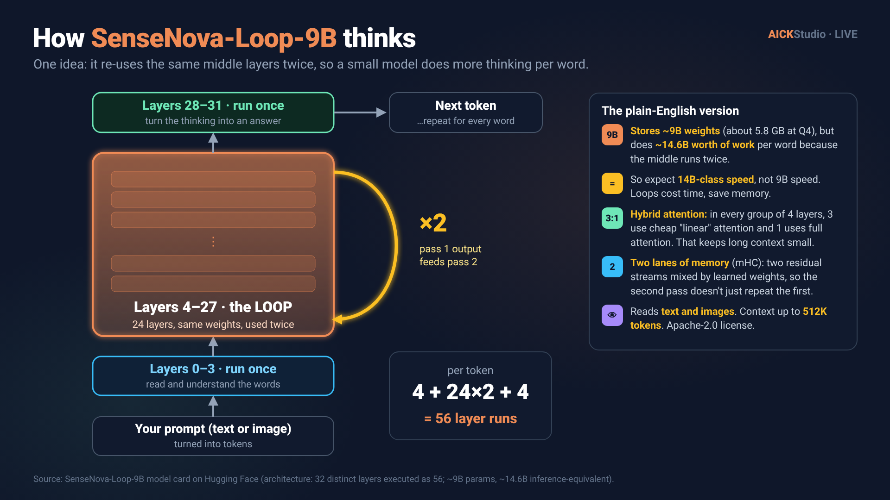
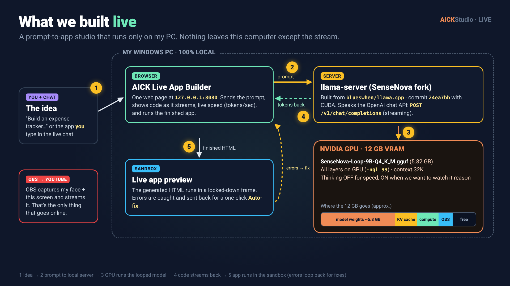

# SenseNova-Loop-9B App Builder (100% local, 12 GB GPU)

Type one prompt and get a working web app, built by a 9B AI model running on your own NVIDIA GPU. No cloud, no API key.

This is the exact kit from the AICK Studio live stream **"Can This 9B AI Build a Working App on 12GB? LIVE"**.
Watch the replay: https://youtube.com/live/JqcdYVTQbEs



## What's inside

| File | What it does |
|---|---|
| `setup.ps1` | One-time setup. Checks your GPU, installs missing build tools, builds SenseNova's llama.cpp fork with CUDA, downloads the model, and runs a speed test. |
| `start-live.ps1` | Loads the model on your GPU and opens the App Builder in your browser. |
| `vram-monitor.ps1` | Small window that shows GPU memory use every second. |
| `ui/index.html` | The App Builder page. llama.cpp serves it at `http://127.0.0.1:8080`. |
| `PROMPTS.md` | Every prompt used on the stream, ready to copy. |

## What you need

- Windows 10 or 11 with an NVIDIA GPU. 12 GB of VRAM is comfortable at Q4. 8 GB may work with a smaller context (`-Ctx 8192`).
- About 15 GB of free disk space on `C:` (build tools, source, the model).
- Internet for the one-time setup. After that, everything runs offline.

**Why not Ollama or LM Studio?** As of November 2026 they can't load this model. It needs SenseNova's own build of llama.cpp, which `setup.ps1` builds for you.

## Quick start (Windows PowerShell)

**1. Get the code**

```powershell
git clone https://github.com/chetankerhalkar/sensenova-loop-9b-app-builder
cd .\sensenova-loop-9b-app-builder
```

No Git yet? Click **Code → Download ZIP** on this page, unzip it, and `cd` into the folder.

**2. Run setup once** (Admin PowerShell; takes 30-60 minutes the first time)

```powershell
Set-ExecutionPolicy -Scope Process Bypass -Force
.\setup.ps1
```

Click **Yes** on any Windows install prompts. It is safe to run again; it skips anything already done. When you see **SETUP COMPLETE**, it prints your speed (tokens/sec) and VRAM.

**3. Start the App Builder**

```powershell
.\start-live.ps1
```

Your browser opens the App Builder once the model is loaded. Keep this window open; closing it stops the model.

**4. Watch VRAM** (optional, in a second PowerShell window)

```powershell
powershell -ExecutionPolicy Bypass -File .\vram-monitor.ps1
```

**5. Build an app**

Click **Everyday**, **Enterprise**, **Game** or **Chat's pick**, then **Build app**. The code streams in live, and the finished app runs in the preview. Use **Improve current app** or **Auto-fix errors** to change or repair it, and **Save** to download the HTML file.

## Options

```powershell
.\start-live.ps1 -Ctx 16384      # smaller context if VRAM gets tight
.\start-live.ps1 -Vision         # also load the image projector (sketch to app, about 0.9 GB more VRAM)
.\setup.ps1 -Quant Q5_K_M        # higher quality model file (6.67 GB)
```

## Tested on

| | |
|---|---|
| GPU | NVIDIA GeForce RTX 5070, 12 GB |
| Toolchain | CUDA 13.5, Visual Studio Build Tools, CMake, Git |
| Model | SenseNova-Loop-9B Q4_K_M (5.82 GB) |
| Setup speed test | 19.3 tokens/sec, 8.7 GB VRAM used (8K context) |

Your numbers will depend on your GPU, driver and context size.

## How it works



1. You type a prompt in the App Builder page.
2. The page sends it to `llama-server` (llama.cpp) on `127.0.0.1:8080`, using the OpenAI-style chat API.
3. Your GPU runs SenseNova-Loop-9B. It stores about 9B weights but runs its middle layers twice, so each word costs about as much as a 14.6B model.
4. The HTML code streams back and shows up as it is written.
5. The finished app runs in a locked-down frame. Any errors are caught, and **Auto-fix errors** sends them back to the model.

## Manual setup (if you'd rather type each step)

Open **Developer PowerShell for VS** first, so the C++ compiler is on your PATH.

```powershell
# 1. Check the GPU
nvidia-smi

# 2. Build tools (skip any you already have)
winget install --id Git.Git -e
winget install --id Microsoft.VisualStudio.2022.BuildTools -e --override "--quiet --wait --add Microsoft.VisualStudio.Workload.VCTools --includeRecommended"
winget install --id Nvidia.CUDA -e

# 3. Get SenseNova's llama.cpp fork at the commit the model card links to
mkdir C:\aick-live; cd C:\aick-live
git clone -b sensenova-loop https://github.com/blueswhen/llama.cpp llama.cpp-sensenova
cd llama.cpp-sensenova
git fetch origin 24ea7bb78410e0f0f7bbb362e37c60cd9ecfc761   # the branch was rebased on Nov 20, so fetch the commit by hash
git checkout 24ea7bb78410e0f0f7bbb362e37c60cd9ecfc761

# 4. Build with CUDA for your GPU only
cmake -B build -DGGML_CUDA=ON -DCMAKE_CUDA_ARCHITECTURES=native -DLLAMA_USE_PREBUILT_UI=OFF -DLLAMA_CURL=OFF
cmake --build build --config Release -j --target llama-server llama-cli

# 5. Download the model (5.82 GB, resumes if it stops)
mkdir C:\aick-live\models
curl.exe -L -C - -o C:\aick-live\models\SenseNova-Loop-9B-Q4_K_M.gguf https://huggingface.co/sensenova/SenseNova-Loop-9B-GGUF/resolve/main/SenseNova-Loop-9B-Q4_K_M.gguf

# 6. Start the model and serve the App Builder (change the --path to where you cloned this repo)
.\build\bin\Release\llama-server.exe -m C:\aick-live\models\SenseNova-Loop-9B-Q4_K_M.gguf --jinja -ngl 99 -c 32768 --port 8080 --path "C:\path\to\sensenova-loop-9b-app-builder\ui"
```

| Flag | Plain English |
|---|---|
| `-ngl 99` | Put every layer on the GPU |
| `-c 32768` | Room for 32K tokens of prompt plus code |
| `--jinja` | Use the chat template inside the model file |
| `--path ...\ui` | Serve the App Builder page |
| `-DLLAMA_USE_PREBUILT_UI=OFF` | Without it, the build looks for a web page that isn't there and stops |

## Use plain llama.cpp, no App Builder

With the model running, this asks llama.cpp for an app and opens the result:

```powershell
$prompt = "Build a tip calculator as one HTML file with a dark theme. Return only the HTML."
$body = @{ messages = @(@{ role = "user"; content = $prompt }); max_tokens = 4000; chat_template_kwargs = @{ enable_thinking = $false } } | ConvertTo-Json -Depth 5
$r = Invoke-RestMethod http://127.0.0.1:8080/v1/chat/completions -Method Post -ContentType "application/json" -Body $body
$t = $r.choices[0].message.content
if ($t -match '(?s)```(?:html)?\s*(.*?)```') { $t = $Matches[1] }
Set-Content "$HOME\Desktop\tip.html" $t -Encoding UTF8
Start-Process "$HOME\Desktop\tip.html"
```

It is quiet for a minute or two while the model writes, because nothing streams.

## If something breaks

| What you see | Fix |
|---|---|
| `unable to read tree (24ea7bb...)` during setup | Pull the latest `setup.ps1` from this repo, which fetches the commit by hash, then run it again. |
| "No CUDA toolset found" | Open a new Admin PowerShell and run `.\setup.ps1` again. Logs are in `C:\aick-live\logs`. |
| Server won't start, or "out of memory" | Quit Ollama and any games, then run `.\start-live.ps1 -Ctx 16384`. |
| Very slow (under 5 tokens/sec) | VRAM is full and layers spilled to the CPU. Use `-Ctx 16384` and keep **Show thinking** off. |
| App Builder shows a red "model offline" dot | The `start-live.ps1` window was closed. Run it again. |
| Build stops halfway | Raise **Max tokens** and press **Improve** with `Finish the file. Return the COMPLETE HTML.` |
| App is blank or broken | Click **Auto-fix errors**. Complex pages can need 2-3 rounds. |

## Credits and license

- Model: [SenseNova-Loop-9B-GGUF](https://huggingface.co/sensenova/SenseNova-Loop-9B-GGUF) by SenseNova (Apache-2.0).
- Runtime: SenseNova's llama.cpp fork, branch `sensenova-loop` at commit `24ea7bb` (MIT, from [ggml-org/llama.cpp](https://github.com/ggml-org/llama.cpp)).
- The scripts and App Builder page in this repo are MIT licensed. See [LICENSE](LICENSE).

Made by Chetan Kerhalkar for [AICK Studio on YouTube](https://www.youtube.com/@AICKStudio). If this helped, subscribe for the next "Will it run on your PC?" test.
